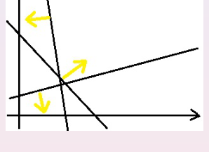
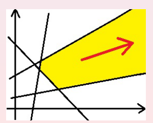
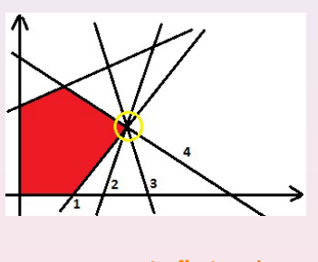
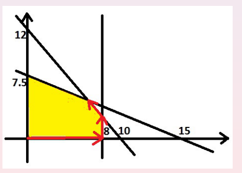

## 1. Geometrical Method and the Simplex Algorithm (p.3)

Linear programming의 최적해를 찾을 때 feasible set의 **vertex(꼭짓점)**를 이용할 수 있다. 최적값이 유한하고 feasible set에 꼭짓점이 존재하면 최적해 중 하나를 꼭짓점에서 찾을 수 있다.

Simplex algorithm은 한 꼭짓점에서 시작해, 목적함수 값을 개선할 수 있는 인접 꼭짓점으로 이동한다. 강의에서는 원점에서 시작할 수 있는 예를 먼저 살펴본다. 일반적인 LP에서는 원점이 feasible하지 않을 수도 있다.

## 2. Algebraic Interpretation of a Vertex (p.4)

부등식 제약에 **slack variable**을 추가한다.

Slack variable을 도입하면 제약을 등식으로 쓰고, 원래 변수와 slack variable에 비음수 조건을 부여할 수 있다. 꼭짓점은 독립적인 제약이 충분히 활성화되는 점에 대응한다. 강의의 tableau 표현에서는 non-basic variable을 0으로 두고 basic variable의 값을 계산한다.

## 3. Initial Simplex Tableau (pp.5–6)

Short simplex tableau의 열은 non-basic variable, 상수항, basic variable 이름으로 구성된다. 처음에는 원래 변수 `x1, ..., xn`이 non-basic이고 slack variable `z1, ..., zm`이 basic이다.

| Basic variable | −x₁ | −x₂ | … | −xₙ | 1 (RHS) |
|---|---:|---:|---:|---:|---:|
| z₁ | a₁₁ | a₁₂ | … | a₁ₙ | b₁ |
| ⋮ | ⋮ | ⋮ | ⋮ | ⋮ | ⋮ |
| zₘ | aₘ₁ | aₘ₂ | … | aₘₙ | bₘ |
| v | −c₁ | −c₂ | … | −cₙ | 0 |

- **Non-basic variables:** 상단에 표시되며 현재 값이 0이다.
- **Basic variables:** 우측에 표시되며 RHS 열의 값을 갖는다.
- **v:** 목적함수와 현재 목적함수 값이다.

한 행은 다음과 같은 등식을 나타낸다.

## 4. Pivot Operation (p.7)

한 꼭짓점에서 다음 꼭짓점으로 이동하려면 basic variable과 non-basic variable을 교환하는 **pivot**을 수행한다. Pivot 위치를 `(i₀, j₀)`로 놓고, 변경 전 원소를 `dᵢⱼ`, 변경 후 원소를 `d̂ᵢⱼ`라고 하자.

Pivot element는 역수로 바뀐다.

Pivot 행의 다른 원소는 pivot element로 나눈다.

Pivot 열의 다른 원소는 부호를 바꾸고 pivot element로 나눈다.

나머지 원소는 다음과 같이 갱신한다.

## 5. Simplex Algorithm — Phase II (p.8)

Phase II는 **feasible basic solution**에서 출발해 목적함수를 최대화하는 과정이다.

1. 목적함수 행에 음수 계수가 남아 있는지 확인한다.
2. 가장 작은 음수 계수에 해당하는 열 `j₀`를 선택한다(entering variable).
3. 해당 열의 계수가 양수인 제약행에 대해서만 RHS / 계수의 비율을 계산한다.
4. 그 비율이 가장 작은 행 `i₀`를 선택한다(leaving variable).
5. `(i₀, j₀)`에서 pivot을 수행하고 반복한다.

Ratio test는 다음과 같다.

들어올 변수를 제한하는 행이 없다면 목적함수는 위로 **unbounded**이다. 목적함수 행에 음수가 없으면 해당 단계에서 종료한다.

## 6. Why Phase I Is Needed (p.9)

원점이 항상 feasible한 것은 아니다. 강의에 나온 예는 다음과 같다.

`x₁ = x₂ = 0`은 두 번째 제약을 만족하지 않는다. 따라서 Phase II 이전에 feasible vertex를 찾는 **Phase I**이 필요하다.

## 7. Simplex Algorithm — Phase I (pp.10–11)

강의에서 제시한 Phase I 절차는 tableau의 RHS가 음수인 행을 대상으로 pivot을 반복한다.

1. RHS가 음수인 행이 있는지 확인한다.
2. 음수 RHS를 가진 행 중 강의의 규칙에 따라 행 `î`를 선택한다.
3. 해당 행에서 음수인 계수를 가진 열 `j₀`를 선택한다.
4. 강의의 ratio test로 pivot 행 `i₀`를 정한다.
5. Pivot 후 다시 RHS를 검사한다.

선택한 행에 필요한 음수 계수가 없다면 feasible set이 **empty**라고 판정한다. RHS가 모두 비음수가 되면 Phase II로 넘어간다.

강의자료 p.11은 **Phase I → Phase II** 순서로 두 절차를 이어서 제시한다.

## 8. Special Cases (pp.12–13)

### 8.1 Empty Feasible Set

제약을 동시에 만족하는 점이 없으면 Phase I에서 이를 판정한다.

*원본 강의 슬라이드: p.12 — Empty feasible set.*

### 8.2 Unbounded Objective Function

Feasible 방향으로 계속 이동하면서 목적함수 값이 무한히 증가할 수 있다면 Phase II에서 unbounded라고 판정한다.

*원본 강의 슬라이드: p.12 — Unbounded objective function.*

### 8.3 Degeneracy and Cycling

두 변수에 비해 지나치게 많은 제약 직선이 하나의 꼭짓점에서 만나는 등 **degenerate vertex**가 있으면 pivot을 반복하더라도 점이 변하지 않을 수 있다. 특정 pivot 선택에서는 이전 tableau로 되돌아가는 **cycling**이 발생할 수 있다.

강의자료에서는 실제 구현 시 tableau 값에 perturbation을 주거나 변수의 label을 이용하는 방식을 언급한다.

*원본 강의 슬라이드: p.13 — Degenerate vertex and cycling.*

## 9. Example 1 — Initial Tableau (p.14)

이전 강의의 LP 예제를 다시 사용한다.

초기 RHS가 모두 비음수이므로 **Phase I 없이 Phase II부터** 시작할 수 있다.

| Basic variable | −x₁ | −x₂ | 1 (RHS) |
|---|---:|---:|---:|
| z₁ | 6 | 5 | 60 |
| z₂ | 1 | 2 | 15 |
| z₃ | 1 | 0 | 8 |
| v | −10 | −9 | 0 |

## 10. Example 1 — Pivot Sequence (pp.15–16)

처음에는 목적함수 행에서 `−10`을 선택한다. Ratio test는 `60/6 = 10`, `15/1 = 15`, `8/1 = 8`이므로 세 번째 행을 pivot 행으로 선택한다. 이후 pivot을 반복하면 강의자료의 최종 tableau를 얻는다.

각 tableau의 상단에는 non-basic variable이, 왼쪽에는 확인을 위한 basic variable 이름이 적혀 있다. Pivot을 수행할 때마다 두 변수의 역할이 바뀐다.

**Step 1. 초기 tableau**

| Basic variable | −x₁ | −x₂ | RHS |
|---|---:|---:|---:|
| z₁ | 6 | 5 | 60 |
| z₂ | 1 | 2 | 15 |
| z₃ | **1** | 0 | 8 |
| v | −10 | −9 | 0 |

**Step 2. x₁이 들어오고 z₃이 나간 후**

| Basic variable | −z₃ | −x₂ | RHS |
|---|---:|---:|---:|
| z₁ | −6 | **5** | 12 |
| z₂ | −1 | 2 | 7 |
| x₁ | 1 | 0 | 8 |
| v | 10 | −9 | 80 |

**Step 3. x₂가 들어오고 z₁이 나간 후**

| Basic variable | −z₃ | −z₁ | RHS |
|---|---:|---:|---:|
| x₂ | −6/5 | 1/5 | 12/5 |
| z₂ | **7/5** | −2/5 | 11/5 |
| x₁ | 1 | 0 | 8 |
| v | −4/5 | 9/5 | 508/5 |

**Step 4. z₃이 들어오고 z₂가 나간 후 (final tableau)**

| Basic variable | −z₂ | −z₁ | RHS |
|---|---:|---:|---:|
| x₂ | 6/7 | −1/7 | 30/7 |
| z₃ | 5/7 | −2/7 | 11/7 |
| x₁ | −5/7 | 2/7 | 45/7 |
| v | 4/7 | 11/7 | 720/7 |

마지막 목적함수 행에는 음수 계수가 없으므로 Phase II가 종료된다.

최종해와 목적함수 값은 다음과 같다.

강의자료는 tableau의 변화를 다음 꼭짓점 이동 경로와 연결한다.

*원본 강의 슬라이드: p.16 — Vertex-to-vertex path.*

## 11. Example 2 — A Problem Requiring Phase I (p.17)

두 번째 예제는 다음과 같다.

이 문제는 초기 tableau의 RHS에 음수 값이 있으므로 Phase I이 필요하다.

| Basic variable | −x₁ | −x₂ | 1 (RHS) |
|---|---:|---:|---:|
| z₁ | −1 | 1 | −1 |
| z₂ | 0 | −1 | −2 |
| z₃ | −1 | 1 | 1 |
| z₄ | 1 | 0 | 4 |
| v | −1 | −2 | 0 |

## 12. Example 2 — Phase I (p.18)

RHS가 음수인 상태에서 pivot을 반복해 feasible tableau를 만든다. 아래는 강의 슬라이드의 중간 tableau와 pivot 위치다.

강의에서는 아래 네 개의 tableau를 순서대로 사용한다. 각 표의 열 제목은 non-basic variable이며, RHS가 모두 비음수가 되면 Phase I을 종료한다.

**Phase I — Initial tableau**

| Basic variable | −x₁ | −x₂ | RHS |
|---|---:|---:|---:|
| z₁ | −1 | 1 | −1 |
| z₂ | 0 | −1 | −2 |
| z₃ | −1 | **1** | 1 |
| z₄ | 1 | 0 | 4 |
| v | −1 | −2 | 0 |

**Pivot 1 — x₂ enters, z₃ leaves**

| Basic variable | −x₁ | −z₃ | RHS |
|---|---:|---:|---:|
| z₁ | 0 | −1 | −2 |
| z₂ | **−1** | 1 | −1 |
| x₂ | −1 | 1 | 1 |
| z₄ | 1 | 0 | 4 |
| v | −3 | 2 | 2 |

**Pivot 2 — x₁ enters, z₂ leaves**

| Basic variable | −z₂ | −z₃ | RHS |
|---|---:|---:|---:|
| z₁ | 0 | **−1** | −2 |
| x₁ | −1 | −1 | 1 |
| x₂ | −1 | 0 | 2 |
| z₄ | 1 | 1 | 3 |
| v | −3 | −1 | 5 |

**Pivot 3 — z₃ enters, z₁ leaves**

| Basic variable | −z₂ | −z₁ | RHS |
|---|---:|---:|---:|
| z₃ | 0 | −1 | 2 |
| x₁ | −1 | −1 | 3 |
| x₂ | −1 | 0 | 2 |
| z₄ | 1 | 1 | 1 |
| v | −3 | −1 | 7 |

최종 RHS가 모두 0 이상이므로 feasible basic solution을 얻었다.

## 13. Example 2 — Phase II (p.19)

Phase I이 끝나 모든 RHS가 비음수가 되면 Phase II를 수행한다. 마지막 tableau의 basic variable 값으로부터 다음 해를 읽을 수 있다.

Phase I 종료 시 tableau에서 시작해, 목적함수 행에 남은 음수 계수를 기준으로 pivot을 한 번 더 수행한다.

**Phase II — Initial tableau**

| Basic variable | −z₂ | −z₁ | RHS |
|---|---:|---:|---:|
| z₃ | 0 | −1 | 2 |
| x₁ | −1 | −1 | 3 |
| x₂ | −1 | 0 | 2 |
| z₄ | **1** | 1 | 1 |
| v | −3 | −1 | 7 |

**Phase II — Final tableau**

| Basic variable | −z₄ | −z₁ | RHS |
|---|---:|---:|---:|
| z₃ | 0 | −1 | 2 |
| x₁ | 1 | 0 | 4 |
| x₂ | 1 | 1 | 3 |
| z₂ | 1 | 1 | 1 |
| v | 3 | 2 | 10 |

따라서 `x₁ = 4`, `x₂ = 3`이고 최댓값은 `10`이다.

---

**Reference**  
Piotr Więcek, *Optimization Theory — Linear Programming Part II: The Simplex Algorithm*, Wrocław University of Science and Technology, 6 November 2026, pp. 1–19.
