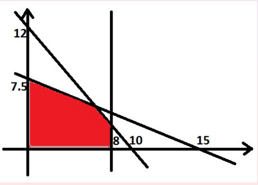
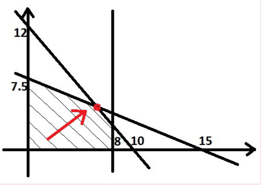
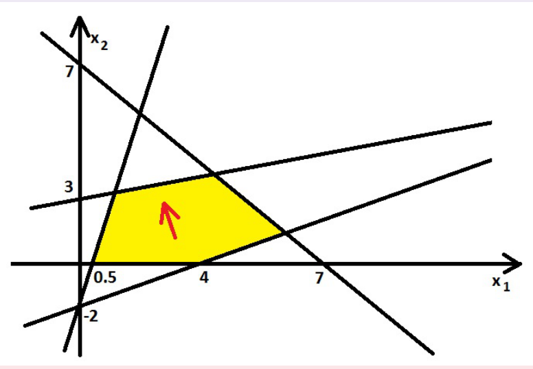
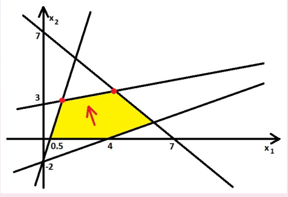
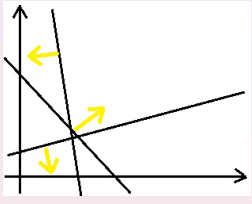
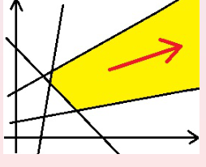

이 글은 선형계획법의 정의와 응용(p.3–10), 동치 변환과 slack variables(p.11–15), 기하학적 풀이와 simplex algorithm의 기본 아이디어(p.16–23)를 다룬다.

---

## 1. What Is Linear Programming? (p.3)

Linear Programming(LP)은 **선형 목적함수**를 **선형 제약조건** 아래에서 최대화하거나 최소화하는 문제다. 강의에서 먼저 제시한 형태는 다음과 같다.

여기서 `x`, `c`는 n차원 벡터, `A`는 m × n 행렬, `b`는 m차원 벡터다. `x ≥ 0`은 각 성분이 음수가 아니라는 뜻이다.

## 2. Simple Example and Matrix Form (pp.4–5)

두 변수에 관한 LP의 예시다.

같은 문제를 행렬로 쓰면 다음과 같다.

따라서 목적함수는 `cᵀx`, 제약조건은 `Ax ≤ b`로 정리된다.

## 3. Applications of LP (pp.6–10)

### 3.1 Production Optimization (p.6)

제조업체는 n개의 제품을 생산할 때 m개의 원자재를 사용한다. 제품 j의 생산량을 `x_j`, 제품당 이익을 `c_j`, 원자재 i의 보유량을 `b_i`, 제품 j 한 단위에 필요한 원자재 i의 양을 `a_ij`라 놓는다.

이익의 합을 최대화하되, 각 원자재의 사용량이 보유량을 넘지 않도록 설정한 문제다.

### 3.2 Diet Problem (pp.7–8)

사료 A는 kg당 $30, B는 kg당 $22다. 영양소 I, II, III가 각각 최소 16g, 54g, 240g 이상이 되도록 하면서 비용을 최소화한다.

| 영양소 (g/kg) | A | B | 최소 필요량 |
|---|---:|---:|---:|
| I | 10 | 6 | 16 |
| II | 22 | 14 | 54 |
| III | 65 | 120 | 240 |

최소 영양 기준을 충족해야 하므로 제약조건의 부등호는 `≥`다.

### 3.3 Transportation Problem (pp.9–10)

m개의 창고에서 n개의 매장으로 물품을 운송한다. 창고 i의 공급량은 `a_i`, 매장 j의 수요량은 `b_j`, 단위 운송비는 `c_ij`, 실제 운송량은 `x_ij`다. 강의에서는 총공급과 총수요가 같다고 가정한다.

각 매장의 수요를 충족하면서 총운송비를 최소화한다.

첫 번째 등식은 각 창고에서 출고하는 총량, 두 번째 등식은 각 매장에 도착하는 총량을 뜻한다.

## 4. Classical and Standard Forms (p.11)

강의에서 **classical form**은 최대화 문제이고 모든 부등식 제약이 `≤`인 형태다.

**Standard form**은 부등식 대신 등식을 사용하는 형태다.

## 5. Slack Variables (p.12)

`≤` 제약을 등식으로 바꾸려면 음수가 아닌 **slack variable(여유변수)**을 추가한다.

p.4의 예시는 다음처럼 바뀐다.

`z_i`는 해당 제약에서 **사용하지 않은 여유량**을 나타낸다. 강의에서는 이 형태를 canonical form이라고도 부른다.

## 6. Equivalent Transformations (p.13)

LP를 classical form으로 바꿀 때 사용하는 동치 변환은 다음과 같다.

**① 부등호 방향 변경**

**② 등식 제약 분해**

**③ 부호 제약이 없는 변수 변환**

**④ 최소화 문제를 최대화 문제로 변경**

## 7. Conversion Example (pp.14–15)

강의의 원래 문제는 다음과 같다.

### 7.1 Classical Form (p.14)

목적함수의 부호를 바꾸고, `≥`를 `≤`로 변환하며, 등식은 두 개의 부등식으로 나눈다.

### 7.2 Standard Form (p.15)

등식 제약은 그대로 두고, 두 부등식에 여유변수를 추가한다.

## 8. Geometrical Solution of an LP (pp.16–18)

변수가 두 개인 LP는 각 제약을 좌표평면에 표시해 풀 수 있다. 모든 제약을 동시에 만족하는 영역이 **feasible set(가능영역)**이다.

*원본 강의 슬라이드. p.16 — 빨간색 feasible set.*

원래 예시의 목적함수 `10x₁ + 9x₂`가 증가하는 방향을 고려하면, 최댓값은 다음 두 직선의 교점에서 얻어진다.

*원본 강의 슬라이드. p.17 — 목적함수 증가 방향과 최적 꼭짓점.*

이 점에서 목적함수의 값은 다음과 같다.

### 8.1 Vertex Method (p.18)

강의에서는 **convex polyhedron의 꼭짓점(vertex)**에 주목한다. 최댓값이 존재하는 LP에서는 적절한 조건 아래 최적 꼭짓점을 찾을 수 있다. 따라서 그림에서 최대가 될 가능성이 있는 꼭짓점의 좌표와 목적함숫값을 비교한다.

1. 제약조건을 그려 feasible set을 구한다.
2. 목적함수의 증가 방향이나 등위선(level lines)을 확인한다.
3. 최댓값 후보인 꼭짓점들의 좌표를 계산한다.
4. 목적함숫값이 가장 큰 점을 선택한다.

## 9. Geometrical Method: Another Example (pp.19–21)

다음 선형계획 문제를 푼다.

가능영역을 그리면 노란색 다각형이 된다. 목적함수 증가 방향에서 후보 꼭짓점 두 개를 비교한다.

*원본 강의 슬라이드. p.20 — 두 번째 예제의 feasible set과 증가 방향.*

첫 번째 후보는 `−4x₁ + x₂ = −2`와 `−x₁ + 4x₂ = 12`의 교점이다.

두 번째 후보는 `−x₁ + 4x₂ = 12`와 `x₁ + x₂ = 7`의 교점이다.

*원본 강의 슬라이드. p.21 — 두 후보 꼭짓점이 표시된 그래프.*

## 10. When Does an LP Have No Optimal Solution? (p.22)

강의에서는 최적해를 갖지 못하는 두 가지 상황을 설명한다.

### 10.1 Empty Feasible Set

제약조건을 동시에 만족하는 점이 없으면 **infeasible**하며 최적해도 존재하지 않는다.

*원본 강의 슬라이드. p.22 — empty feasible set.*

### 10.2 Unbounded Objective Function

가능영역 안에서 목적함수 값을 계속 증가시킬 수 있으면 최대값이 유한하게 정해지지 않는다.

*원본 강의 슬라이드. p.22 — unbounded objective function.*

## 11. Connection to the Simplex Algorithm (p.23)

기하학적 관점에서 simplex algorithm은 **feasible set의 꼭짓점에서 인접한 꼭짓점으로 이동하면서 목적함숫값을 개선**하는 방법이다.

1. 먼저 feasible vertex를 찾는다.
2. 목적함숫값을 증가시키는 인접 방향을 확인한다.
3. 개선 가능한 방향이 있다면 다음 꼭짓점으로 이동한다.
4. 더 이상 개선할 인접 방향이 없으면 최적성 여부를 판단한다.

강의의 단순 예시에서는 원점이 가능하지만, 모든 LP에서 원점이 feasible한 것은 아니다. 실제 simplex algorithm에서는 초기 feasible vertex를 구하는 절차가 별도로 필요할 수 있다.

---

**Reference**  
Piotr Więcek, *Optimization Theory — Linear Programming Part I*, Wrocław University of Science and Technology, 4 November 2026.  

